# Excelデータを使用した簡易レポートの作成

## **ラボ概要**

みらいリテールの営業企画部に所属するデータ分析担当者として、営業責任者から依頼された売上実績分析レポートを作成します。最初にExcelの売上データをPower BI Desktopへ読み込み、カード、集合縦棒グラフ、折れ線グラフ、スライサーを配置します。このページはラボ04で完成レポートへ発展させるため、作り直さずに残します。

- Power BI Desktopを起動してPBIXファイルを保存する
- Excelテーブルから売上データを読み込む
- カード、集合縦棒グラフ、折れ線グラフ、スライサーを作成する
- スライサーによるビジュアルの連動を確認する

**このラボの実施には約15分かかります。**

使用するファイルと保存するPBIXは次のとおりです。

| 項目 | 内容 |
|---|---|
| 使用ファイル | `C:\PowerBITraining\Excel\売上データ_研修用.xlsx` |
| 保存するPBIX | `みらいリテール_売上実績分析.pbix` |

> 注：レポートを作り始める前に「誰が、何を判断するために見るのか」を決めます。今回は、営業責任者が売上規模、カテゴリ比較、推移、地域別の絞り込みを確認することを想定します。

## **Power BI Desktopを起動してExcelデータを読み込む**

このタスクでは、Power BI Desktopを起動して作業ファイルを保存し、Excelテーブルから売上データを読み込みます。

### 1. Power BI Desktopを開いて保存する

1. デスクトップのショートカットからPower BI Desktopを起動します。

2. スタート画面が表示された場合は**空のレポート**を選択します。

3. 画面右上に**サインイン**と表示されている場合は選択し、演習用アカウントでサインインします。

   演習で使用するアカウント情報は以下の通りです。

   | 項目       | 値                                                           |
   | ---------- | ------------------------------------------------------------ |
   | メール     | **PBIUser##@ctctedu.onmicrosoft.com** ※##の部分には仮想マシンに付与されているものと同じ個別の数字が入ります。 |
   | パスワード | **講師より配布された演習用仮想マシンのパスワードと同一**     |

   > このデバイスですべてのアプリとWebサイトにサインインしますか？では"はい"を選びます。演習環境内ではPower BI Desktop以外にもMicrosoft EdgeでPower BI Service利用のために演習用アカウントを使用します。

4. リボンメニューの **ファイル** から **名前を付けて保存**を選択します。

5. **このデバイスを参照する** をクリックして **ドキュメント** を保存先として指定します。ファイル名は `みらいリテール_売上実績分析.pbix` として保存します。

左側で棒グラフの形をした**レポート ビュー**が選択され、中央に白いキャンバス、右側に**フィルター**、**視覚化**、**データ**の各ペインがあることを確認します。

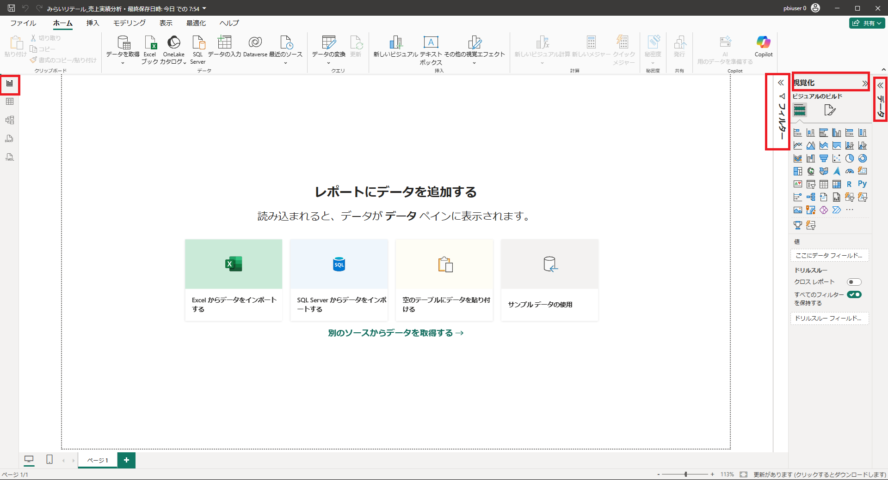

### 2. Excelテーブルを読み込む

1. **ホーム**リボンの**Excelブック**を選択します。見つからない場合は**データを取得**→**Excelブック**を選択します。

   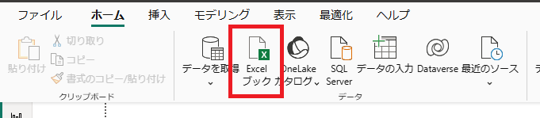

   > 新しいデータ取得エクスペリエンスを提案された場合は"いいえ"を選択してください。本研修では従来のエクスペリエンスを使用します。

2. エクスプローラーが表示され、`C:\PowerBITraining\Excel\売上データ_研修用.xlsx` を選択し、**開く**を選択します。

3. **ナビゲーター**の左側で、テーブルアイコンが付いた `SalesTrainingTable` を選択して、チェックボックスをオンにします。

   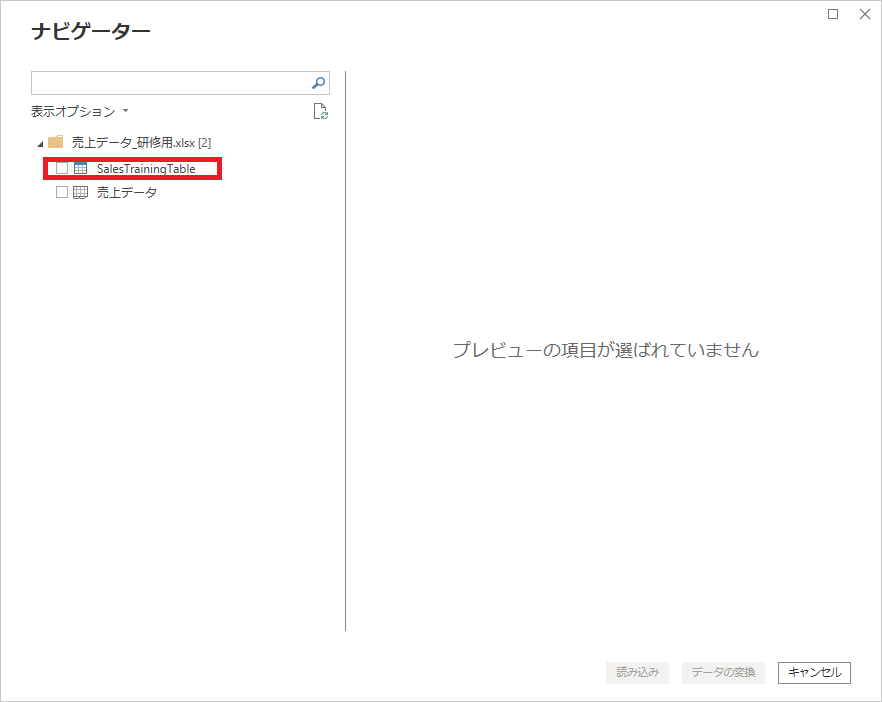

4. プレビューに `売上日`、`地域`、`商品カテゴリ`、`売上金額` などの列があることを確認します。

5. **読み込み**を選択します。

6. レポート画面へ戻るまで待ち、**データ**ペインに `SalesTrainingTable` が表示されたことを確認します。

   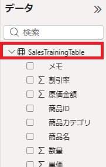

## **簡易レポートを作成する**

このタスクでは、営業責任者が売上の全体像を確認できるように、4つの基本ビジュアルを1ページへ配置します。

### 3. ページ名とタイトルを設定する

1. 画面下部の `ページ 1` をダブルクリックし、`売上サマリー` と入力します。

   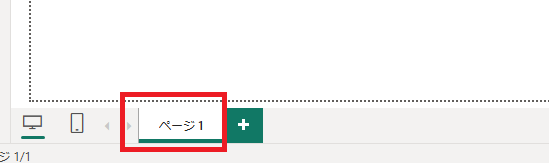

2. ダブルクリックで編集できない場合は、ページタブを右クリックして**名前の変更**を選択します。

3. **挿入**→**テキスト ボックス**を選択します。

   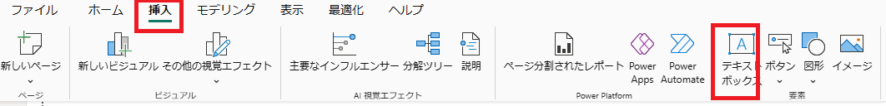

4. フォントサイズを36に設定し、`売上サマリー` と入力、ページ左上へ配置します。

### 4. 売上合計カードを作る

1. キャンバスの空白部分をクリックします。

   > 新しいビジュアルを配置する場合は、一度既存のビジュアルの選択を外す必要があります。

2. **視覚化**ペインの **ビジュアルのビルド** で、標準の **カード** を選択します。

   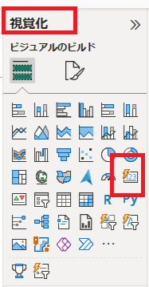

3. 画面右側の **データ** ペインで `SalesTrainingTable` の左側の矢印をクリックし、列の一覧を展開します。

4. `売上金額` を、**ビジュアルのビルド** の **値** 欄へドラッグします。

   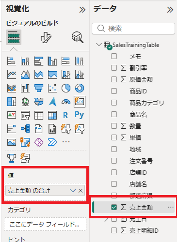

5. **値** 欄の `売上金額` のメニューを開き、集計方法が **合計** であることを確認します。

   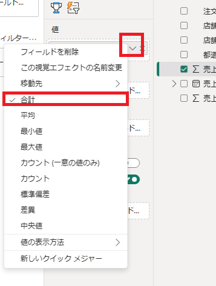

6. **ビジュアルの書式設定** の **ビジュアル** タブを選び、**吹き出し** を展開します。

   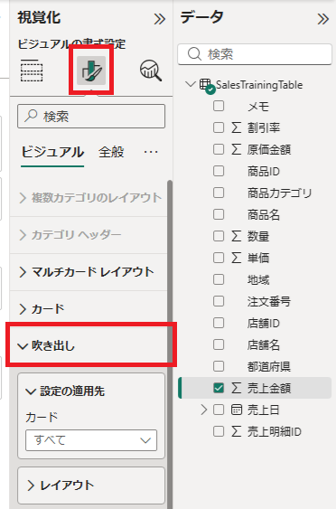

7. **設定の適用先** にある **カード** のドロップダウンを開き、**すべて** ではなく、`売上金額の合計` を選択します。

8. 同じ **吹き出し** の中にある **値** を展開し、**表示単位** を **なし** にします。項目が見えない場合は、書式設定ペイン内を下へスクロールします。

9. カードをページ上部へ移動します。

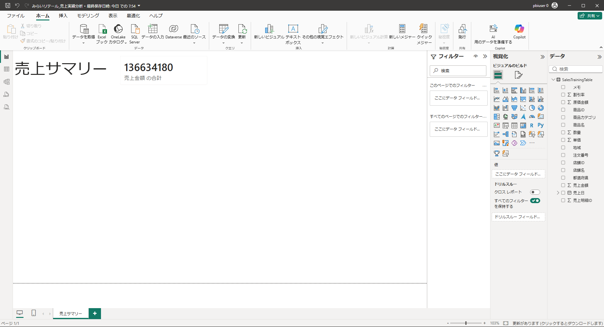

カードに1つの大きな数値が表示されれば成功です。整形前データのため、現時点の値は最終値と一致しません。

### 5. 残りのビジュアルを作る

新しいビジュアルを追加するときは、最初にキャンバスの空白を選択します。既存ビジュアルを選択したまま種類を選ぶと、既存ビジュアルが置き換わります。

次の表を上から順に設定します。`売上金額` の集計方法はすべて**合計**です。

| ビジュアル | フィールドの配置 | タイトル | 配置 |
|---|---|---|---|
| 集合縦棒グラフ | X軸: `商品カテゴリ` / Y軸: `売上金額` | 商品カテゴリ別 売上 | 中央上 |
| 折れ線グラフ | X軸: `売上日` / Y軸: `売上金額` | 売上推移 | 中央下 |
| スライサー | フィールド: `地域` | 地域 | 右側 |

最初に集合縦棒グラフを作成し、その後、同じ要領で折れ線グラフとスライサーを作成します。アイコンにマウスポインターを合わせると、ビジュアルの名前が表示されます。

1. キャンバスの白い場所を選択します。

2. 右側の **視覚化** ペインで、表のビジュアル名と一致するアイコンをクリックします。キャンバスに空のビジュアルが表示され、枠が選択されます。

3. 右側の **データ** ペインで `SalesTrainingTable` を展開します。集合縦棒グラフでは `商品カテゴリ` を **視覚化** ペインの **X軸** 欄へ、`売上金額` を **Y軸** 欄へドラッグします。

4. キャンバスの空白を選択してから **折れ線グラフ** を選択し、`売上日` を **X軸** 欄、`売上金額` を **Y軸** 欄へドラッグします。X軸の項目が **日付階層** になった場合は、項目の右端の下向き矢印をクリックして `売上日` を選びます。

5. キャンバスの空白を選択してから **スライサー** を選択し、`地域` を **フィールド** 欄へドラッグします。

6. 作成したビジュアルを1つずつ選択し、**視覚化** ペイン上部の **ビジュアルの書式設定**（ペイントブラシのアイコン）→**全般**→**タイトル**を開き、オンにして表のタイトルを入力します。

   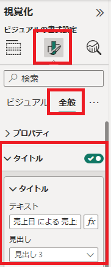

7. 各ビジュアルの外枠をドラッグして配置し、四隅や辺のハンドルをドラッグして大きさを調整します。

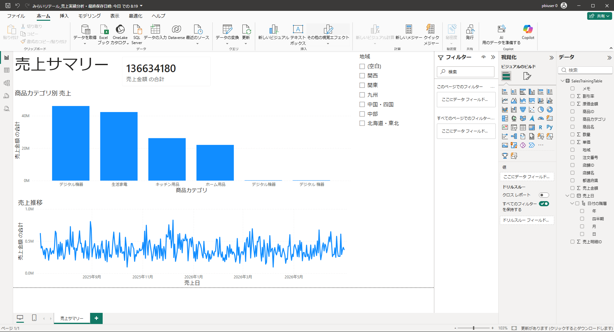

## **レポートの動作を確認する**

このタスクでは、地域スライサーを操作し、ページ上のビジュアルが連動することを確認します。

### 6. スライサーの連動を確認して保存する

1. 地域スライサーで任意の地域を1つ選択します。
2. カード、集合縦棒グラフ、折れ線グラフが変化することを確認します。
3. スライサー右上の**選択解除**（消しゴムのアイコン）をクリックします。
4. すべての地域を含む表示へ戻ったことを確認します。
5. Ctrl+Sを押して保存します。

## ラボの完了

ここまでの作業結果を確認し、PBIXファイルを保存して本ラボを完了します。

- `みらいリテール_売上実績分析.pbix` を保存している
- ページ名が `売上サマリー` になっている
- 売上合計カード、商品カテゴリ別の集合縦棒グラフ、売上推移の折れ線グラフ、地域スライサーがある
- 地域スライサーを選ぶと3つのビジュアルが変化する

## 困ったときは

### 既存のビジュアルが別の種類に変わった

Ctrl+Zで戻します。キャンバスの白い場所を選択してから、新しいビジュアルを追加します。

### 売上金額が「カウント」になった

カードを選択し、**ビジュアルのビルド** の **値** 欄にある `売上金額` のメニューを開いて、**合計**を選択します。

### 折れ線の横軸が階層表示になった

X軸の `売上日` のメニューを開き、**日付階層**ではなく `売上日` を選択します。ラボ04で月単位へ変更します。
