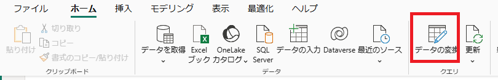
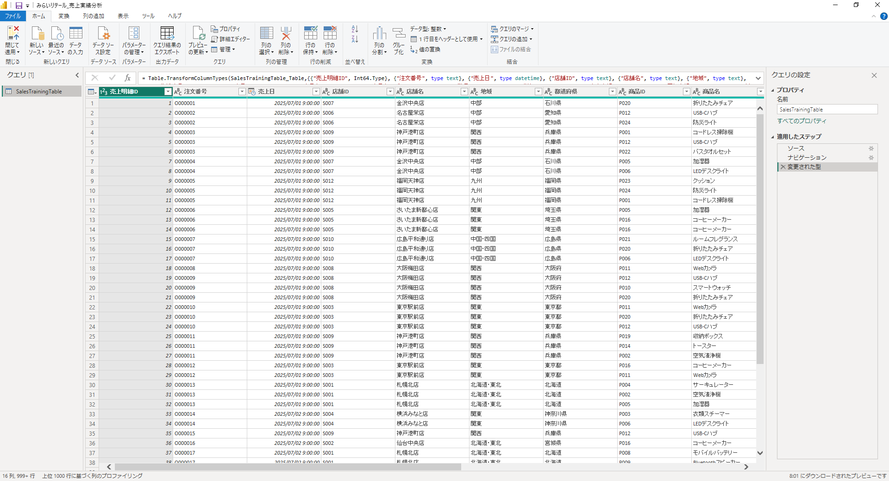
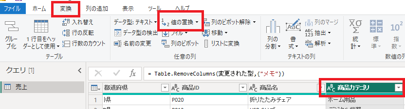
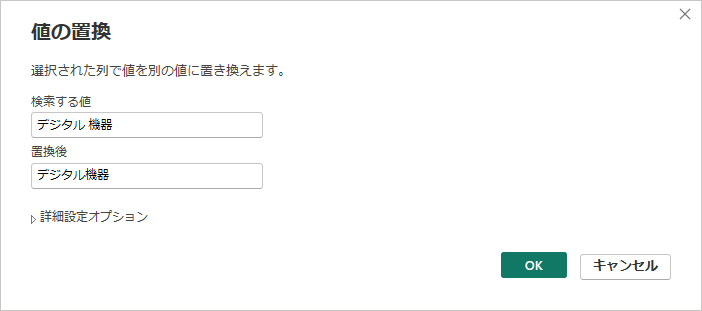
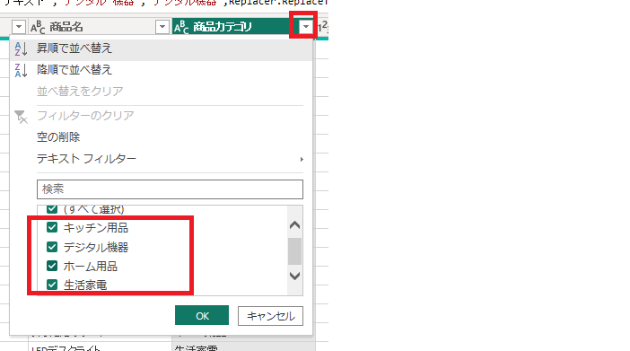
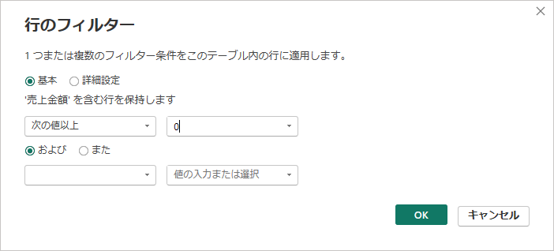
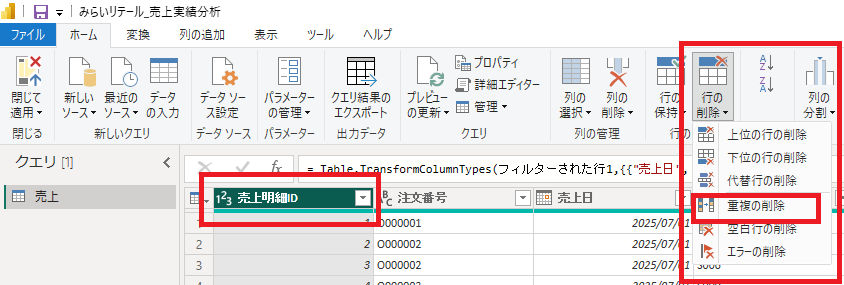

# Power Queryを使用したデータの加工と変換

## **ラボ概要**

ラボ01で読み込んだ売上クエリをPower Queryエディターで整えます。不要列の削除、文字列の統一、行のフィルター、データ型の設定、重複の削除を行い、作成済みレポートへ結果を反映します。

- Power Queryエディターで不要な列と行を削除する
- 商品カテゴリの表記とデータ型を整える
- 重複を削除して処理履歴を確認する
- 加工結果をレポートへ反映する

**このラボの実施には約20分かかります。**

このラボは、ラボ01を完了した `みらいリテール_売上実績分析.pbix` を開いた状態から開始します。ラボ01で作成した4つのビジュアルは、そのまま使用します。

## **Power Queryエディターで売上データを整える**

このタスクでは、売上クエリに含まれる不要列、表記ゆれ、分析対象外の行、重複を順番に整えます。実行した操作は、Power Queryエディターの適用したステップに処理履歴として記録されます。

### 1. Power Queryエディターを開く

1. `みらいリテール_売上実績分析.pbix` が開いていることを確認します。

2. **ホーム**→**データの変換**を選択します。

   

3. Power Queryエディターが別ウィンドウで開くまで待ちます。

   

4. 左側の**クエリ**ペインで `SalesTrainingTable` を選択します。

5. クエリを右クリックして**名前の変更**を選び、`売上` と入力します。

中央はデータのプレビュー、右側は**クエリの設定**です。変換操作を行うと、クエリの設定にある**適用したステップ**へ処理が追加されます。

### 2. 不要な列を削除する

1. プレビューの右端付近にある `メモ` 列を選択します。
2. 列見出しを右クリックし、**削除**を選択します。
3. `メモ` 列が消え、**適用したステップ**に列削除のステップが追加されたことを確認します。

### 3. 商品カテゴリの表記を統一する

1. `商品カテゴリ` 列を選択します。

2. 列見出しを右クリックし、**変換**→**トリミング**を選択します。

3. 同じ列を選択したまま、リボンメニューの**変換**→**値の置換**を選択します。

   

4. **検索する値**に `デジタル 機器`、**置換後**に `デジタル機器` と入力します。

   

5. **OK**を選択します。

6. `商品カテゴリ` のフィルターボタンを開き、次の4種類になったことを確認します。

   - キッチン用品
   - デジタル機器
   - ホーム用品
   - 生活家電

   

7. チェック状態を変更せず、フィルターメニューの外側を選択します。

トリミングは文字列の前後にある空白を除きます。文字列の途中にある空白は残るため、値の置換も使用しています。

### 4. 分析対象外の行を除外する

> 注：欠損や負数を見つけても、実務ではすぐに削除せず、返品、取消、未登録などの業務上の意味を確認します。本ラボでは、あらかじめ分析対象外と決めた行だけを除外します。

#### 店舗IDが空白の行

1. `店舗ID` 列の見出し右端にある下向き矢印（フィルターボタン）を選択します。一覧が表示されます。

2. 一覧で `(null)` または空白のチェックを外します。

   > nullが表示されない場合は、フィルター画面の右下にある**さらに読み込み**をクリックしてリスト表示を拡張します

3. **OK**を選択します。

#### 売上金額が負の行

1. `売上金額` 列の見出し右端にある下向き矢印を選択します。

2. **数値フィルター**→**指定の値以上**を選択します。

3. 値に `0` と入力し、**OK**を選択します。

   

### 5. データ型を確認する

列見出しの左側には、`ABC`、`123`、カレンダーなどのデータ型アイコンがあります。次の表と異なる列だけ変更します。

| 列 | データ型 |
|---|---|
| 売上明細ID、数量、単価、売上金額、原価金額 | 整数 |
| 注文番号、店舗ID、店舗名、地域、都道府県、商品ID、商品名、商品カテゴリ | テキスト |
| 売上日 | 日付 |
| 割引率 | 10進数 |

型を変更する場合は、列見出し左の型アイコンを選び、目的の型を選択します。複数列をまとめて変更する場合は、Ctrlキーを押しながら列見出しを選択し、選択済みのいずれかの列見出しを右クリックして**型の変更**を使用します。

### 6. 重複を削除する

1. `売上明細ID` 列だけを選択します。

2. ウィンドウ上部の **ホーム** タブで **行の削除** の下向き矢印をクリックし、表示された一覧から **重複の削除** を選択します。

   

3. **適用したステップ**に重複削除のステップが追加されたことを確認します。

重複の判定に使う列は、選択中の列です。今回は売上明細を一意に表す `売上明細ID` だけを選択します。

### 7. 処理履歴を確認する

1. 右側の**適用したステップ**を上から順に選択します。
2. 選択した時点のデータへプレビューが戻ることを確認します。
3. 最後のステップを選択し、次の結果を確認します。

| 確認項目 | 完成値 |
|---|---|
| クエリ名 | `売上` |
| 列数 | 15列 |
| 商品カテゴリ | 4種類 |

## **加工したデータをレポートへ反映する**

このタスクでは、Power Queryで行った処理をPower BI Desktopへ適用し、ラボ01で作成したレポートの表示を確認します。

### 8. レポートへ反映する

1. リボンメニューの**ホーム**→**閉じて適用**を選択します。
2. Power BI Desktopへ戻るまで待ちます。
3. **データ**ペインのテーブル名が `売上` になっていることを確認します。
4. 商品カテゴリ別の棒が4本になっていることを確認します。
5. 売上合計カードが `136,615,781` になっていることを確認します。
6. 地域スライサーを1つ選択し、作成済みの3つのビジュアルが変化することを確認します。
7. スライサーの選択を解除し、Ctrl+Sで保存します。

## ラボの完了

加工結果とレポートの表示を確認し、PBIXファイルを保存して本ラボを完了します。

- クエリ名が `売上` になっている
- `メモ` 列が削除されている
- 商品カテゴリが4種類に統一されている
- 店舗IDの空白行、負の売上、重複IDが除外されている
- `売上` が15列になり、指定した行が除外されている（完成データは7,612行）
- 作成済みレポートが保たれ、売上合計が136,615,781になっている

## 困ったときは

### フィルター後にデータが0行になった

**適用したステップ**で直前のステップに戻り、誤ったフィルターステップの左側にある**×**を選択して削除します。その後、条件を設定し直します。

### 商品カテゴリが4種類にならない

**適用したステップ**に**トリミングされたテキスト**と**置き換えられた値**の両方があることを確認します。
