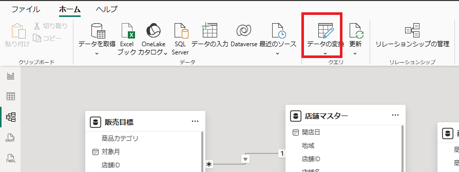
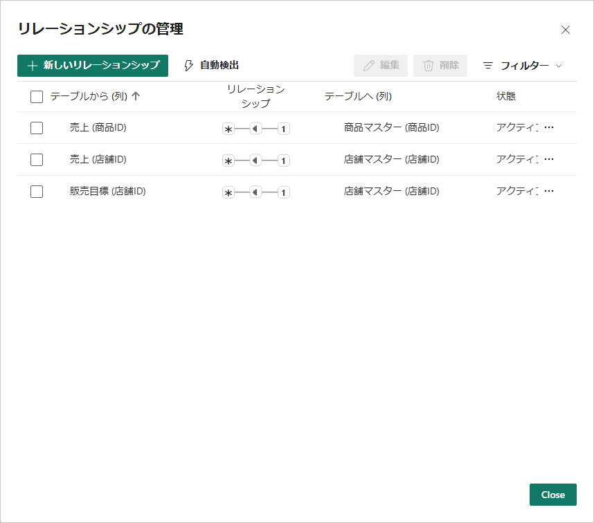
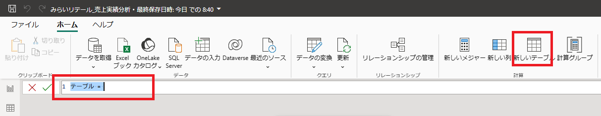
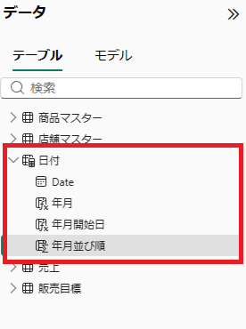
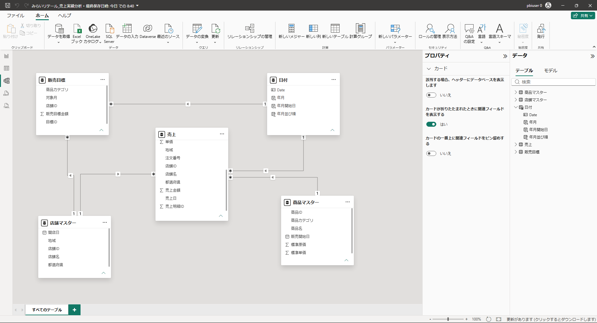
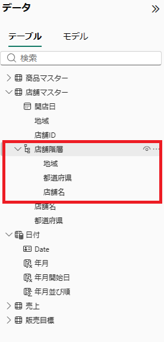

# 複数データを使用したデータモデリングとDAX

## **ラボ概要**

ラボ02の売上データへ、SQL Serverの商品・店舗マスターとSharePoint Onlineリストの販売目標を追加します。5つのテーブルをリレーションシップで結び、店舗階層、計算列、DAXメジャーを作成します。

- SQL ServerとSharePoint Onlineリストからデータを追加する
- テーブル間のリレーションシップを作成する
- 日付テーブルと店舗階層を作成する
- 計算列とDAXメジャーを作成する

**このラボの実施には約35分かかります。**

このラボは、ラボ02を完了した `みらいリテール_売上実績分析.pbix` を開いた状態から開始します。完了時には、5テーブル、5リレーションシップ、1階層、1計算列、5メジャーが作成されています。

## **使用するデータ**

商品・店舗・販売目標は、標準経路またはフォールバックのどちらか一方だけを読み込みます。フォールバックはデータベースやSharePointのデータが読み取れない場合の回避策として、サンプルファイルベースのデータソースを示しています。

| データ | 標準経路 | フォールバック | 完成テーブル | 件数 |
|---|---|---|---|---:|
| 売上明細 | ラボ02のExcel | なし | `売上` | 7,612行 |
| 商品 | SQL Server `dbo.商品マスター` | `商品マスター.xlsx` | `商品マスター` | 24行 |
| 店舗 | SQL Server `dbo.店舗マスター` | `店舗マスター.xlsx` | `店舗マスター` | 12行 |
| 販売目標 | SharePointリスト `販売目標` | `販売目標.xlsx` | `販売目標` | 576行 |

完成モデルは次の形です。

```text
商品マスター（1）──（*）売上（*）──（1）店舗マスター
                         │                 │
                         │                 └──（*）販売目標
                         │                         │
                    日付（1）──────────────（*）┘
```

売上は明細単位、販売目標は月・店舗・商品カテゴリ単位です。粒度が異なるため、売上と販売目標は直接結びません。

## **複数のデータソースからデータを追加する**

このタスクでは、SQL Serverの商品・店舗マスターと、SharePoint Onlineリストの販売目標をPower BIへ追加します。接続できないデータソースだけ、用意されているExcelへ切り替えます。

### 1. 商品・店舗マスターを追加する

1. `みらいリテール_売上実績分析.pbix` で**ホーム**→**データの変換**を選択します。

2. Power Queryエディターで**ホーム**→**新しいソース**→**SQL Serverデータベース**を選択して接続します。

3. 次の値を入力して**OK**を選択します。

   | 項目 | 値 |
   |---|---|
   | サーバー | `localhost` |
   | データベース | `PowerBITraining` |
   | データ接続モード | インポート |

4. **ナビゲーター**で `商品マスター` と `店舗マスター` のチェックボックスをオンにして**OK**を選択します。

5. クエリ名が `商品マスター`、`店舗マスター` になっていることを確認します。

6. `商品マスター` が24行、`店舗マスター` が12行であることを確認します。

#### SQL Serverへ接続できない場合

次のExcelテーブルを読み込みます。標準経路で読み込めた場合、この操作は行いません。

| ファイル | 選択するExcelテーブル | クエリ名 |
|---|---|---|
| `C:\PowerBITraining\Fallback\商品マスター.xlsx` | `ProductMasterTable` | `商品マスター` |
| `C:\PowerBITraining\Fallback\店舗マスター.xlsx` | `StoreMasterTable` | `店舗マスター` |

**ホーム**→**新しいソース**→**Excelブック**から1ファイルずつ追加し、**ナビゲーター**で表に示したテーブルを選択します。

### 2. SharePointの販売目標を追加する

1. Power Queryエディターで**ホーム**→**新しいソース**→**SharePoint Onlineリスト**を選択します。
2. サイトURLに `https://ctctedu.sharepoint.com/sites/power-bi-fundamentals` と入力します。
3. **実装**または**実装方式**を選べる場合は `2.0` を選択します。
4. **OK**を選択します。
5. 認証を求められた場合は**Microsoftアカウント**を選び、Power BI Desktopと同じ研修用アカウントでサインインします。
6. **ナビゲーター**で `販売目標` を選択し、**OK**を選択します。
7. 次の5列だけを残します。Ctrlキーを押しながら列見出しを選択し、いずれかを右クリックして**他の列の削除**を選択します。

   - `目標ID`
   - `年月`
   - `店舗ID`
   - `商品カテゴリ`
   - `販売目標金額`

8. `年月` 列を右クリックして**名前の変更**を選び、`対象月` とします。
9. `対象月` のデータ型を**日付**、`販売目標金額` を**整数**へ変更します。
10. `対象月` のフィルターボタンを開き、2025年7月1日から2026年6月1日まで、すべて月初の日付になっていることを確認します。チェック状態を変えずにメニューを閉じます。
11. クエリ名が `販売目標`、行数が576行であることを確認します。

`対象月` が前月末へずれている場合は、日付型への変更だけでは修正できません。いったんクエリを削除して実装方式 `2.0` で接続し直すか、次のフォールバックを使用します。

#### SharePointへ接続できない場合

`C:\PowerBITraining\Fallback\販売目標.xlsx` の `SalesTargetFallbackTable` を読み込みます。クエリ名を `販売目標` とし、`年月` 列がある場合は `対象月` へ変更します。

### 3. クエリを適用する

1. 左側の**クエリ**ペインに `売上`、`商品マスター`、`店舗マスター`、`販売目標` の4つがあることを確認します。
2. 標準経路とフォールバックの両方を読み込んでいないことを確認します。
3. **ホーム**→**閉じて適用**を選択します。
4. Power BI Desktopへ戻ったら、左側の**モデル ビュー**を選択します。

## **データモデルを作成する**

このタスクでは、テーブル間のリレーションシップ、日付テーブル、店舗階層を作成します。

> 注：リレーションシップの「1」側に置くキーは一意である必要があります。複数テーブルに同じ列名があっても、自動検出だけに任せず、キー、方向、カーディナリティを確認します。

### 4. 3つの基本リレーションシップを作る

画面左端のビュー切り替えアイコンから **モデル ビュー** を選びます。テーブルが箱として表示されます。関係線が自動作成されている場合も内容を確認します。関係線がない場合は、表の1側のテーブルを探し、指定された列名を多側テーブルの指定列名までドラッグします。表示されたダイアログで両テーブルと列、カーディナリティ、クロスフィルター方向、アクティブの設定を表と照合し、**保存** または **OK** を選択します。

| 1側テーブル | 列 | 多側テーブル | 列 | カーディナリティ | クロスフィルター方向 |
|---|---|---|---|---|---|
| 商品マスター | 商品ID | 売上 | 商品ID | 一対多 | 単一 |
| 店舗マスター | 店舗ID | 売上 | 店舗ID | 一対多 | 単一 |
| 店舗マスター | 店舗ID | 販売目標 | 店舗ID | 一対多 | 単一 |

1. **ホーム**→**リレーションシップの管理**を選択します。

   

2. 表の3関係があり、すべて**アクティブ**であることを確認します。

   

3. 不要な関係が自動作成されている場合は、その関係だけを選択して**削除**します。

4. **閉じる(close)**を選択します。

### 5. 日付テーブルと列を作る

1. **ホーム**→**新しいテーブル**を選択します。

   

2. 数式バーに次のDAXを入力し、Enterキーを押します。

   > 最初から挿入されている"テーブル ="は削除して式を上書きします

```DAX
日付 =
CALENDAR(
    DATE(2025, 7, 1),
    DATE(2026, 6, 30)
)
```

3. データペインで`日付` テーブルを選択し、リボンメニューの **新しい列**を選択します。
4. 数式バーに以下の式を入力して、3つの列をそれぞれ作成します。各式を入力するたびにEnterキーで確定します。

```DAX
年月 = FORMAT('日付'[Date], "yyyy年M月")
```

```DAX
年月開始日 = DATE(YEAR('日付'[Date]), MONTH('日付'[Date]), 1)
```

```DAX
年月並び順 = YEAR('日付'[Date]) * 100 + MONTH('日付'[Date])
```

5. 日付テーブルは以下のような列構成になっていればOKです。

   

6. **データ**ペインで `日付[年月]` を選択します。

7. **プロパティ**ペインで詳細を展開し、**列で並べ替え**の項目で `年月並び順` を選択します。

8. **データ**ペイン`日付` テーブルを右クリックし、**日付テーブルとしてマーク**を選択します。

9. **日付テーブルとしてマーク** をオンにして、日付列に `Date` を指定して確定します。

### 6. 日付のリレーションシップを作る

モデルビューで、日付テーブルの `Date` 列を各テーブルの指定列へドラッグします。表示される**新しいリレーションシップ**の画面で表の設定と照合し、**保存** または **OK** を選択します。これを2つの関係について繰り返します。

| 1側テーブル | 列 | 多側テーブル | 列 | カーディナリティ | クロスフィルター方向 |
|---|---|---|---|---|---|
| 日付 | Date | 売上 | 売上日 | 一対多 | 単一 |
| 日付 | Date | 販売目標 | 対象月 | 一対多 | 単一 |

作成後、5本すべての関係線が実線であることを確認します。



### 7. 店舗階層と地理カテゴリを設定する

1. **データ**ペインで `店舗マスター` を展開します。

2. `地域` を右クリックして**階層の作成**を選択します。

3. 作成された階層を右クリックして**名前の変更**を選び、`店舗階層` とします。

4. `都道府県` を右クリックし、**階層に追加**→ `店舗階層` を選択します。

5. `店舗名` も同じ方法で `店舗階層` へ追加します。

6. 階層を展開し、`地域` → `都道府県` → `店舗名` の順であることを確認します。

   

7. `都道府県` 列を選択します。

   > 階層内ではなく、テーブル直下の列項目を選択します

8. プロパティペインの詳細を展開し、**データ カテゴリ**→**州または都道府県**を選択します。

## **計算列とDAXメジャーを作成する**

このタスクでは、明細行ごとに値を保持する計算列と、フィルター条件に応じて再計算されるメジャーを作成します。

### 8. 計算列を作る

1. **データ**ペインで `売上` テーブルを選択します。
2. **新しい列**を選択します。
3. 次のDAXを入力してEnterキーを押します。

```DAX
値引額 =
ROUND('売上'[単価] * '売上'[数量] * '売上'[割引率], 0)
```

計算列は各売上明細に1つずつ値を保持します。テーブルビューに切り替えることで `値引額` 列が追加され、数値が入っていることが確認できます。

### 9. 5つのメジャーを作る

1. `売上` テーブルを右クリックして**新しいメジャー**を選択します。
2. 次の式を1つずつ入力します。式を確定した後、同じ操作で次のメジャーを作ります。

```DAX
売上合計 = SUM('売上'[売上金額])
```

```DAX
粗利益 = SUM('売上'[売上金額]) - SUM('売上'[原価金額])
```

```DAX
粗利率 = DIVIDE([粗利益], [売上合計])
```

3. `販売目標` テーブルを右クリックして**新しいメジャー**を選択し、次の2つを作ります。

```DAX
販売目標合計 = SUM('販売目標'[販売目標金額])
```

```DAX
目標達成率 = DIVIDE([売上合計], [販売目標合計])
```

4. `粗利率` と `目標達成率` をそれぞれ選択し、**メジャー ツール**で形式を**パーセンテージ**、小数点以下を1桁にします。
5. `売上合計`、`粗利益`、`販売目標合計` は、桁区切りをオンにします。

メジャーはフィルターやスライサーの選択に応じて再計算されます。先ほどの計算列とは異なり、テーブルビューで値が確認できません。

### 10. モデルを確認して保存する

1. **レポート ビュー**へ戻り、`売上サマリー` の売上合計カードを選択します。
2. **視覚化** ペインの **ビジュアルのビルド** を開き、カードの **値** 欄にある既存の `売上金額` の横の **×** を選択して削除します。
3. **データ** ペインで `売上` テーブルを展開し、電卓アイコンが付いた `売上合計` メジャーを、カードの **値** 欄へドラッグします。値が2つ残らないように確認します。
4. カードの値が `137M` となったことを確認します。
5. Ctrl+Sで保存します。

## ラボの完了

モデルと計算結果を確認し、PBIXファイルを保存して本ラボを完了します。

- `売上`、`商品マスター`、`店舗マスター`、`販売目標`、`日付` の5テーブルがある
- 商品、店舗、日付を起点とする5本の一対多・単方向の関係がある
- `店舗階層` が地域 → 都道府県 → 店舗名の順になっている
- `都道府県` のデータカテゴリが設定されている
- 計算列 `値引額` がある
- `売上合計`、`粗利益`、`粗利率`、`販売目標合計`、`目標達成率` の5メジャーがある

## 困ったときは

### SQL ServerまたはSharePointへ接続できない

標準経路とフォールバックを同時に読み込まず、接続できないデータソースだけExcelへ切り替えます。クエリ名は必ず表の完成テーブル名に合わせます。

### リレーションシップが多対多になる

1側に指定した `商品マスター[商品ID]`、`店舗マスター[店舗ID]`、`日付[Date]` に重複がないか確認します。販売目標の店舗IDは重複するため、販売目標を1側にはしません。

### DAX式でエラーが出る

テーブル名と列名を**データ**ペインから確認します。日本語名を含むテーブルは、式の例と同じように単一引用符で囲みます。

### 販売目標合計が空白になる

`日付[Date]` と `販売目標[対象月]`、`店舗マスター[店舗ID]` と `販売目標[店舗ID]` の関係が実線になっているか確認します。
