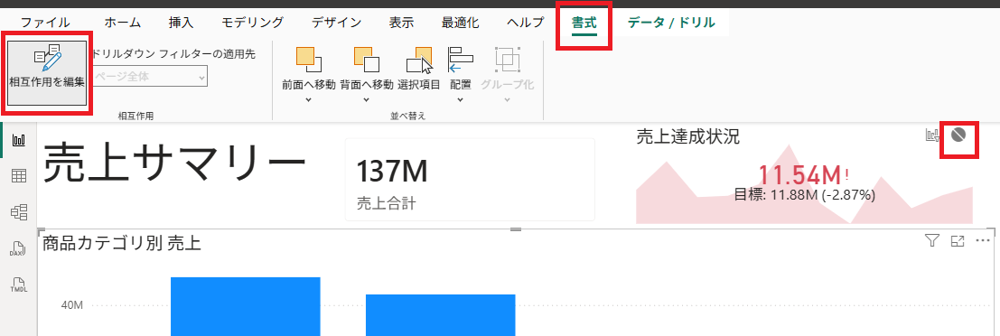
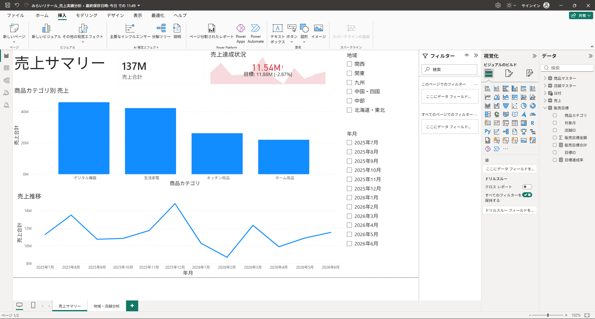
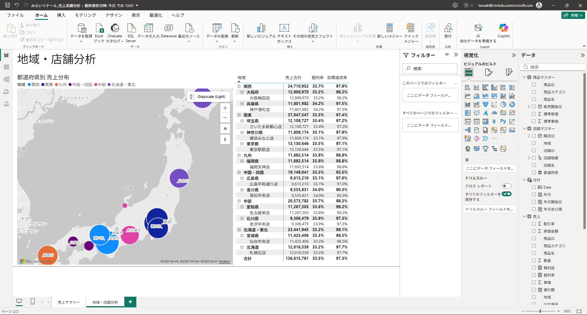
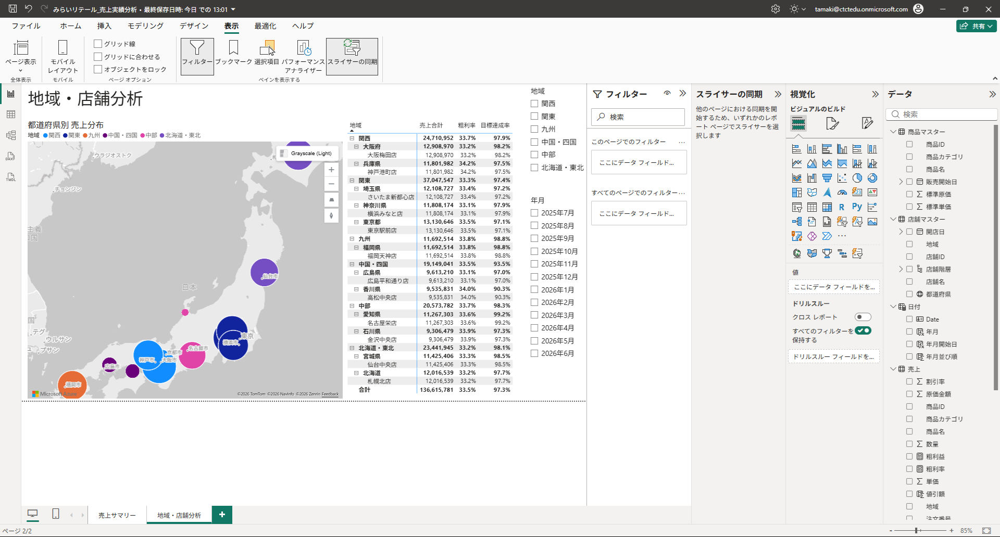

# Power BI Desktopを使用した業務レポートの作成

## **ラボ概要**

ラボ01で作成した簡易レポートを、ラボ03のモデルとメジャーを使用する「売上サマリー」へ更新します。さらに「地域・店舗分析」ページを追加し、KPI、Azure Maps、店舗階層のマトリクス、同期スライサーを作成します。

- 既存ビジュアルをモデルの列とメジャーへ置き換える
- KPIビジュアルで実績と目標を比較する
- Azure Mapsと店舗階層のマトリクスを作成する
- 年月と地域のスライサーを2ページで同期する

**このラボの実施には約30分かかります。**

このラボは、ラボ03を完了した `みらいリテール_売上実績分析.pbix` を開いた状態から開始します。完了時には、`売上サマリー` と `地域・店舗分析` の2ページが作成されています。

## **完成するページ**

| ページ | ビジュアル |
|---|---|
| 売上サマリー | 売上合計カード、カテゴリ別縦棒、月別折れ線、KPI、年月・地域スライサー |
| 地域・店舗分析 | Azure Maps、店舗階層マトリクス、年月・地域スライサー |

## **売上サマリーページを更新する**

このタスクでは、ラボ01で作成した簡易レポートを、ラボ03で作成したモデルとメジャーを使用する売上サマリーへ更新します。

### 1. 売上サマリーのフィールドをモデルへ置き換える

ラボ01のビジュアルを残し、フィールドだけを次の表に合わせます。キャンバス上の対象ビジュアルをクリックし、右側の **視覚化** ペインで **ビジュアルのビルド** を開きます。表の「取り除く項目」が入っている欄を探し、その項目の右端の **×** をクリックします。続けて、右側の **データ** ペインで表に示されたテーブルを矢印で展開し、列またはメジャーを指定先の欄へドラッグします。表の各行について繰り返します。

| ビジュアル | 取り除く項目 | 追加する項目 |
|---|---|---|
| 売上合計カード | 変更なし | `売上合計` メジャーが入っていることを確認 |
| 商品カテゴリ別 縦棒 | X軸の `売上[商品カテゴリ]`、Y軸の `売上[売上金額]` | X軸: `商品マスター[商品カテゴリ]` / Y軸: `売上[売上合計]` |
| 売上推移 折れ線 | X軸の `売上[売上日]`、Y軸の `売上[売上金額]` | X軸: `日付[年月]` / Y軸: `売上[売上合計]` |
| 地域スライサー | `売上[地域]` | `店舗マスター[地域]` |

折れ線グラフの年月が正しい順に並ばない場合は、モデルで `日付[年月]` が `年月並び順` によって並べ替えられているか確認します。

### 2. 年月スライサーを追加する

1. キャンバスの白い場所を選択します。
2. **視覚化**ペインで**スライサー**を選択します。
3. `日付[年月]` をスライサーの**フィールド**へドラッグします。
5. 年月スライサーを地域スライサーの下に配置します。
6. 任意の1か月を選択し、カード、棒グラフ、折れ線グラフが変化することを確認します。
7. 選択を解除します。

### 3. KPIビジュアルを作る

KPIへ変換した後は並べ替えを変更できない場合があるため、先に縦棒グラフで日付を昇順にします。

1. キャンバスの白い場所を選択します。

2. **集合縦棒グラフ**を選択します。

3. X軸へ `日付[年月開始日]`、Y軸へ `売上[売上合計]` を配置します。

4. 縦棒グラフが選択された状態で、**視覚化**ペインの**KPI**を選択します。

5. フィールドを次の状態にします。

   | KPIのフィールド | 設定する項目 |
   |---|---|
   | 値またはインジケーター | `売上[売上合計]` |
   | トレンド軸 | `日付[年月開始日]` |
   | ターゲットまたは目標 | `売上[販売目標合計]` |

6. KPIを選択したまま、右側の **視覚化** ペイン上部で **ビジュアルの書式設定** を選び、**全般**→**タイトル** を開いてオンにします。テキストに `売上達成状況` と入力します。

7. **ビジュアルの書式設定** の **ビジュアル** タブを選択し、**トレンド軸** を展開します。**方向** で **高いと良好** を選択します。項目名や配置はPower BI Desktopのバージョンにより異なる場合があります。

8. 同じくビジュアルの書式設定のビジュアルタブで**吹き出しの値** を展開し、**表示単位** を**百万** にします。

9. KPIを売上合計カードの横へ配置します。

KPIはトレンド軸の最新時点の実績と目標を比較します。年月スライサーを選択すると、選択範囲内の最新月が表示されます。

販売目標データには商品カテゴリがありますが、今回のモデルでは商品カテゴリのフィルターが販売目標テーブルへ伝わりません。集合縦棒グラフにおいて商品カテゴリの棒を選択したとき、売上だけがカテゴリで絞られたKPIへ変わらないよう、ビジュアル間の作用を調整します。

1. 商品カテゴリ別の集合縦棒グラフを選択します。

2. リボンメニューの**書式**から**相互作用の編集**を選択します。

3. KPIの上部に表示されたアイコンのうち、斜線の入った円の **なし** を選択します。アイコンにマウスポインターを合わせると名前を確認できます。

   

4. もう一度**相互作用の編集**を選択して終了します。

### 4. 売上サマリーの配置を整える

次の配置を目安に、タイトルや軸ラベルが読める大きさへ整えます。

## **地域・店舗分析ページを作成する**

このタスクでは、Azure Mapsと店舗階層のマトリクスを使用して、地域から店舗まで掘り下げられるページを作成します。

> 注：地図は分布の把握に向きますが、値の正確な比較には表やグラフを併用します。

### 5. 地域・店舗分析ページを追加する

1. 画面下部の**＋**を選択して新しいページを追加します。
2. ページタブをダブルクリックし、`地域・店舗分析` と入力します。
3. **挿入**→**テキスト ボックス**を選択し、フォントサイズを28に設定してから`地域・店舗分析` と入力して左上へ配置します。

### 6. Azure Mapsを作る

1. キャンバスの白い場所を選択します。

2. **視覚化**ペインで**Azure Maps**（矢印アイコン）を選択します。

3. Azure Mapsが選択された状態で、右側の **視覚化** ペインの **ビジュアルのビルド** を開きます。**データ** ペインで `店舗マスター`、`売上`、`販売目標` を必要に応じて展開し、次の項目を対応する欄へドラッグします。欄が見えない場合は **視覚化** ペイン内をスクロールします。

   > 地図が表示されない場合は、Power BI Desktopで演習用アカウントを使用してサインインを行ってください

   | Azure Mapsのフィールド | 設定する項目 |
   |---|---|
   | 場所 | `店舗マスター[都道府県]` |
   | サイズ | `売上[売上合計]` |
   | 凡例 | `店舗マスター[地域]` |
   | ツールヒント | `店舗マスター[店舗名]`、`粗利益`、`目標達成率` |

4. 地図を選択したまま、**視覚化** ペイン上部のペイントブラシのアイコン **ビジュアルの書式設定** を選択します。**全般**→**タイトル** を開いてオンにし、テキストに `都道府県別 売上分布` と入力します。

5. 地図をページ左側へ大きく配置します。

6. 日本国内に12個の都道府県が表示されることを確認します。

7. 任意のマーカーへマウスポインターを合わせ、店舗名、売上、粗利益、目標達成率を確認します。

都道府県が海外へ表示される場合は、`店舗マスター[都道府県]` のデータカテゴリが**都道府県または州**になっているか確認します。

### 7. 店舗階層のマトリクスを作る

1. キャンバスの白い場所を選択します。
2. **視覚化**ペインで**マトリクス**を選択します。
3. `店舗マスター[店舗階層]` 全体を**行**へドラッグします。個別の `地域` だけを選ばないよう注意します。
4. **値**へ次のメジャーを順に追加します。

   - `売上合計`
   - `粗利益`
   - `目標達成率`

5. マトリクスを選択したまま、**ビジュアルの書式設定**→**全般**→**タイトル** を開いてオンにし、テキストに `店舗別 指標` と入力します。
6. マトリクスをページ右側へ配置します。
7. マトリクス右上にある**階層内で1レベル下をすべて展開します**アイコン（二股に分かれた矢印）を2回選択します。
8. 1回目で地域 → 都道府県、2回目で都道府県 → 店舗名まで展開されることを確認します。

## **ページをまたいだ設定を行う**

このタスクでは、年月と地域のスライサーを2ページで同期し、ページ間で同じ条件を使用できるようにします。

> 注：同期するスライサーは、ページ間で同じ位置と表示形式にすると利用者が迷いにくくなります。

### 8. 年月スライサーを2ページで同期する

1. `売上サマリー` ページへ戻ります。

2. 年月スライサーを選択します。

3. リボンメニューで**表示**→**スライサーの同期**を選択します。

4. 右側の**スライサーの同期**ペインで、`売上サマリー` と `地域・店舗分析` の2行を確認します。

5. 両ページの行で、循環する矢印のアイコンが付いた **同期** 列のチェックボックスをオンにします。

6. 同じ2行で、目のアイコンが付いた **表示** 列のチェックボックスもオンになっていることを確認します。

7. `地域・店舗分析` ページへ移動し、年月スライサーが表示されていることを確認します。

8. スライサーをページ右側へ移動します。

   

**同期**は選択状態を共有する設定、**表示**はそのページにスライサーを表示する設定です。

### 9. 地域スライサーを2ページで同期する

1. `売上サマリー` ページへ戻ります。
2. 地域スライサーを選択します。
3. 先ほどと同様に**スライサーの同期**ペインで、2ページの**同期**と**表示**をオンにします。
4. `地域・店舗分析` ページへ移動し、地域スライサーを年月スライサーの近くへ配置します。

### 10. ページ間の連動を確認する

1. `売上サマリー` ページで、年月に `2026年6月`、地域に任意の1地域を選択します。
2. カード、KPI、縦棒、折れ線が選択条件に合わせて変化することを確認します。
3. `地域・店舗分析` ページへ移動します。
4. 年月と地域に同じ値が選択されていることを確認します。
5. Azure Mapsとマトリクスが同じ条件へ絞り込まれていることを確認します。
6. Azure Mapsで任意のマーカーを選択し、マトリクスが絞り込まれることを確認します。
7. 地図上のマーカー以外の場所をクリックして、選択状態を解除します。
8. 年月スライサーと地域スライサーの選択を解除します。
9. `売上サマリー` に戻り、選択が解除されていることを確認します。
10. Ctrl+Sで保存します。

## ラボの完了

2ページの表示と連動を確認し、PBIXファイルを保存して本ラボを完了します。

- `売上サマリー` と `地域・店舗分析` の2ページがある
- 売上サマリーにカード、集合縦棒、折れ線、KPI、年月・地域スライサーがある
- KPIが `売上合計`、`年月開始日`、`販売目標合計` を使用している
- 商品カテゴリ別の棒を選択してもKPIが変化しない
- 地域・店舗分析にAzure Mapsと店舗階層のマトリクスがある
- マトリクスを地域 → 都道府県 → 店舗名へ展開できる
- 年月と地域のスライサーが2ページで同期する
- Azure Mapsの選択がマトリクスへ反映される

## 困ったときは

### KPIが空白、または古い月を表示する

トレンド軸が `日付[年月開始日]` であることを確認します。並べ替えが必要な場合は、いったん集合縦棒グラフへ戻して `年月開始日` の昇順にし、再度KPIへ変換します。

### KPIの目標が空白になる

`日付[Date]` と `販売目標[対象月]` の関係がアクティブか確認します。ターゲットには列ではなく `販売目標合計` メジャーを使用します。

### マトリクスに階層のアイコンが表示されない

個別の `地域`、`都道府県`、`店舗名` ではなく、複数段のアイコンが付いた `店舗階層` 全体を**行**へ配置します。

### スライサーが別ページへ反映されない

対象スライサーを選択し、**スライサーの同期**ペインで2ページの**同期**がオンになっているか確認します。表示されていても、**同期**がオフの場合は選択状態が共有されません。

