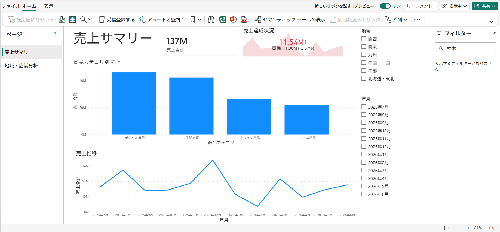

# Power BI Serviceを使用した発行と共有

## **ラボ概要**

完成した `みらいリテール_売上実績分析.pbix` を、自分用の `みらいリテール 営業分析（受講者ID）` ワークスペースへ発行します。Power BI Serviceで2ページのレポートとセマンティックモデルを確認し、KPIをダッシュボードへピン留めして、営業責任者へ提供するアプリを作成します。

- Power BI Desktopからワークスペースへレポートを発行する
- レポートとセマンティックモデルを確認する
- KPIをダッシュボードへピン留めする
- レポートとダッシュボードを含むアプリを発行する

**このラボの実施には約15分かかります。**

このラボは、ラボ04を完了した `みらいリテール_売上実績分析.pbix` を開いた状態から開始します。完了時には、自分用のワークスペースにレポート、セマンティックモデル、ダッシュボード、アプリが作成されています。

## **レポートをPower BI Serviceへ発行する**

このタスクでは、Power BI Desktopで作成したレポートを、自分用のワークスペースへ発行してブラウザーで確認します。

### 1. PBIXを保存して発行する

1. Power BI Desktopで `みらいリテール_売上実績分析.pbix` が開いていることを確認します。
2. `売上サマリー` と `地域・店舗分析` の2ページがあることを確認します。
3. 年月と地域のスライサーの選択を解除します。
4. Ctrl+Sで保存します。
5. 画面右上に研修用アカウントが表示されていることを確認します。**サインイン**と表示されている場合はサインインします。
6. リボンメニューで**ホーム**→**発行**を選択します。
8. **マイ ワークスペース**が宛先となっていることを確認して**選択**を押します。
9. 完了メッセージが表示されるまでPower BI Desktopを閉じずに待ちます。
10. 完了画面のは**Power BIで`みらいリテール_売上実績分析`を開く**を選択します。

ここから先はWebブラウザーのPower BI Serviceで操作します。URLに `app.powerbi.com` が含まれていることを確認します。

### 2. 発行したレポートを確認する

1. 発行直後のレポート名が、PBIXのファイル名と同じ `みらいリテール_売上実績分析` になっていることを確認します。業務利用時の表示名は、後の手順で読みやすく変更します。
2. `売上サマリー` と `地域・店舗分析` の2ページがあることを確認します。
3. `売上サマリー` で年月と地域を1つずつ選択します。
4. カード、KPI、縦棒、折れ線が変化することを確認します。
5. `地域・店舗分析` へ移動します。
6. 同じ年月と地域が選択され、Azure Mapsとマトリクスが絞り込まれていることを確認します。
7. Azure Mapsのマーカーへマウスポインターを合わせ、売上、粗利益、目標達成率を確認します。
8. スライサーの選択を解除します。

## **ワークスペースの内容を確認する**

このタスクでは、発行によって作成されたレポートとセマンティックモデルを確認します。

> 注：実務では、発行後にデータソース資格情報、ゲートウェイ、更新スケジュールを設定します。本ラボでは画面の確認のみ行います。

### 3. ワークスペースの項目を確認する

1. 画面左側のナビゲーションで **ワークスペース** を選択し、開いた一覧から**マイワークスペース**を選択します。ナビゲーションが折りたたまれている場合は、左上のメニューアイコンから展開します。
2. コンテンツ一覧で `みらいリテール_売上実績分析` という名前の項目を確認します。

   | 型 | 含まれるもの |
   |---|---|
   | レポート | ページ、ビジュアル、スライサー |
   | セマンティック モデル | テーブル、関係、DAX、データソース情報 |

3. 型が**レポート**の行で**…**→**設定**を選択します。
4. レポート名を `みらいリテール 売上実績分析` に変更します。セマンティックモデルは、元の名前のままで構いません。
5. 種類が**セマンティック モデル**の行で**…**→**設定**を選択します。
6. **ゲートウェイとクラウド接続**、**データ ソースの資格情報**、**最新の情報に更新**の設定領域があることを確認します。
7. 値は変更せず、ワークスペースへ戻ります。

ローカルのExcelやオンプレミスSQL ServerをServiceから更新するには、オンプレミスデータゲートウェイなどの構成が必要です。本ラボでは設定しません。

## **ダッシュボードを作成する**

このタスクでは、重要なKPIをダッシュボードへピン留めしてダッシュボードの作成方法と動作を確認します。

### 4. KPIをダッシュボードへピン留めする

1. ワークスペースから種類が**レポート**の `みらいリテール 売上実績分析` を開きます。
2. `売上サマリー` ページを開きます。
3. `売上達成状況` KPIへマウスポインターを合わせます。
4. ビジュアル右上の**ピンのアイコン**を選択します。表示されない場合は**…**のメニューを確認します。
5. **新しいダッシュボード**を選択します。
6. ダッシュボード名に `売上・目標達成KPI` と入力します。
7. **ピン留め**を選択します。
8. 完了メッセージで**ダッシュボードへ移動**を選択します。
9. KPIが1つのタイルとして表示されることを確認します。
10. タイルをクリックすると元のレポートへ移動することを確認します。

## **共有方法の使い分け**

| 方法 | 主な対象 | 特徴 |
|---|---|---|
| ワークスペース | 作成・運用チーム | ロールを使って共同作業する場所 |
| レポート | 分析する利用者 | 複数ページを操作して詳しく見る |
| ダッシュボード | 状況を一覧したい利用者 | 重要なタイルを1ページに集める |
| アプリ | 部門などの閲覧者 | 完成したコンテンツをまとめて配布する |

「Webに公開」は匿名でインターネットへ公開される可能性があるため、この研修では使用しません。

## ラボの完了

Power BI Serviceに作成された項目を確認し、本ラボを完了します。

- 自分用のワークスペースへ発行し、レポート名を `みらいリテール 売上実績分析` に変更した
- レポートとセマンティックモデルを見分けられた
- Service上で2ページと同期スライサーを確認した
- 自分のワークスペースロールを確認した
- KPIを1つのダッシュボードタイルとしてピン留めした
